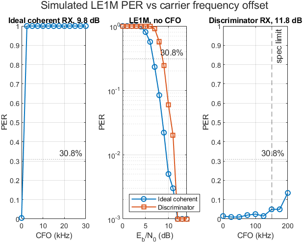
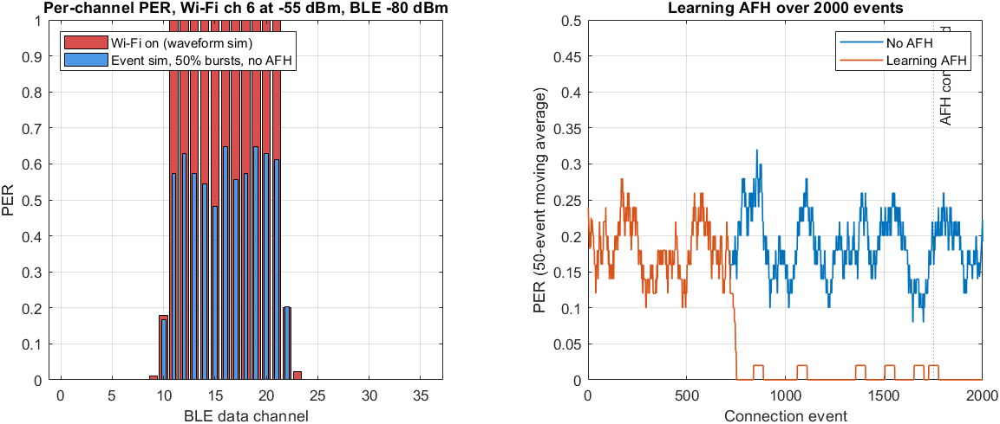

# BLE Link Performance Simulation (MATLAB)

Link-level simulation of Bluetooth Low Energy in MATLAB: all four LE PHYs, a realistic
noncoherent receiver, indoor multipath, RF impairments, RF-PHY receiver and transmitter
conformance tests, ray-traced indoor coverage, and Wi-Fi coexistence with a learning
adaptive frequency hopping (AFH) algorithm.

All results are **simulated** (fixed random seeds, reproducible). The full write-up with
every table and figure is in [BLE_Demo_Report.pdf](BLE_Demo_Report.pdf).

## Highlights

| Topic | Result (from the committed run) |
|---|---|
| Sensitivity at 30.8% PER, ideal RX, 7 dB NF, 1000 pkts/point | -100.2 dBm (LE1M), -97.2 (LE2M), -104.1 (LE500K), -108.3 (LE125K) |
| Carrier frequency offset | Toolbox ideal RX fails from 2.5 kHz; the noncoherent RX here keeps PER at 5.0% at the 150 kHz spec limit, for a 2 dB Eb/No cost |
| Indoor multipath (Rician K = 6 dB / Rayleigh) | Penalty vs AWGN at 30.8% PER: 3.8 / 4.3 dB (LE1M), 2.8 / 3.9 dB (LE125K) |
| Impairment budget (LE1M) | 150 kHz CFO +1.27 dB, -70 dBc/Hz phase noise +1.85 dB, 30% DC offset +0.98 dB, 50 ppm clock drift ~0 dB |
| Receiver tests at RF-PHY spec levels | C/I, blocking, intermodulation for 3 DUTs; 2 regressions caught; intermod passes down to IIP3 -37.5 dBm |
| Ray-traced coverage (MATLAB `office.stl`, -20 dBm TX) | 99.1% (LE1M), 90.8% (LE2M), 100% (LE125K) of points reached by rays |
| Wi-Fi coexistence, 2000 connection events | PER 18.5% without AFH, 7.0% with learning AFH (0.0% after convergence) |

<p align="center">
  <br>
  
</p>

## Requirements

- MATLAB R2022b (tested; R2021a+ should work) with Bluetooth Toolbox, Communications Toolbox,
  Signal Processing Toolbox. Antenna Toolbox is used for ray tracing (Step 12).
- The Step 10 and 11 tests call helper functions from MathWorks' Bluetooth examples, loaded
  from your MATLAB install (`matlabroot/examples/bluetooth/main`); they are not included here.
- Optional, for the PDF report: Python 3 with `reportlab`.

## Run

```matlab
run_all            % all 13 steps, ~15-20 min; or run any stepN_... script on its own
```

Rebuild the report from the results:

```matlab
addpath report; export_results_json      % writes results/report_data.json
```
```bash
python report/make_report.py
```

## Steps

| Step | Script | What it does |
|---|---|---|
| 1 | `step1_waveforms_hopping.m` | 4 LE PHYs, GFSK, CSA #1 hopping, AFH vs Wi-Fi channel 6 |
| 2 | `step2_per_sweep.m` | PER waterfall per PHY, 30.8% point, sensitivity in dBm |
| 3 | `step3_impairments.m` | CFO: ideal coherent RX vs noncoherent discriminator RX |
| 4 | `step4_link_budget_coverage.m` | Link budget, range, coverage on a toy floor plan |
| 5 | `step5_test_suite.m` | Sensitivity / C/I pass-fail suite with regression check |
| 6 | `step6_coexistence.m` | Analytic Wi-Fi coexistence, with and without AFH |
| 7 | `step7_summary.m` | Prints the Step 1-6 headline numbers |
| 8 | `step8_multipath.m` | AWGN / Rician / Rayleigh indoor fading, penalty vs AWGN |
| 9 | `step9_impairments.m` | Eb/No cost of CFO, timing drift, phase noise, DC offset |
| 10 | `step10_rx_tests.m` | C/I, blocking, intermod at spec levels; IIP3 sweep |
| 11 | `step11_tx_tests.m` | TX power, modulation characteristics, CFO and drift |
| 12 | `step12_raytrace_coverage.m` | Ray-traced indoor coverage and PHY selection |
| 13 | `step13_coexistence.m` | Bursty masked Wi-Fi, learning AFH over 2000 events |

Core functions: `blePerSim.m` (TX -> channel/impairments/interference -> RX, PER/BER),
`blePhyParams.m`, `bleChanFreqMHz.m`, `wifiOverlap.m`, `ebnoAtPer.m`, `perFromEbno.m`.
`results/` holds the `.mat`, `.csv`, `.json` outputs and `results/figs/` the figures.

## Model limitations

- Noise figure (7 dB) and nominal front-end IIP3 (-20 dBm) are assumptions.
- The toolbox GFSK waveform has no inter-symbol interference, so receiver results are slightly
  optimistic and the TX modulation ratio is not representative of real hardware.
- Blocking passes trivially: ideal digital channel filter, input-referred noise, no LO
  reciprocal mixing.
- Wi-Fi is modelled as spectral-mask-shaped Gaussian noise with random bursts, not real traffic.
- The coded-PHY noncoherent receiver uses internal toolbox functions (`ble.internal.*`), which
  may change between MATLAB releases.

See the report's "Not done / limitations" section for the full list.

## License

MIT - see [LICENSE](LICENSE).
